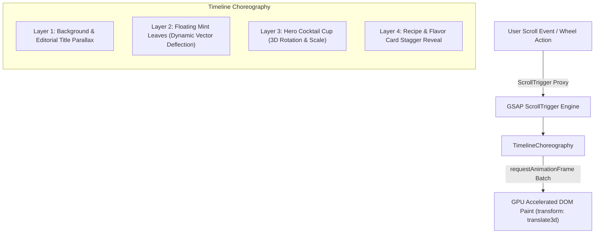

# 🍸 Mojito — 3D Interactive Beverage Showcase & GSAP Scroll Choreography

<div align="center">


**A high-craft interactive beverage experience demonstrating multi-layer parallax scroll choreography, fluid typography, and timeline animations built with React, TypeScript, and GSAP.**

[](https://gsap-cocktails-five-gamma.vercel.app/)
[](https://greensock.com/gsap/)
[](https://react.dev/)
[](https://vitejs.dev/)
[](https://tailwindcss.com/)
[](https://web.dev/rendering-performance/)

</div>

---

## 📖 Overview

**Mojito** is a flagship creative frontend project built to explore the boundaries of web storytelling and browser motion design. Moving far beyond static e-commerce product grids, it crafts an immersive, sensorial journey through artisan cocktails using scroll-driven timeline animations, depth-layered parallax, and fluid interactive transitions.

Powered by the **GreenSock Animation Platform (GSAP)**, `@gsap/react`, and **ScrollTrigger**, the project translates user scroll velocity into physics-based leaf deflections, floating ice rotations, and multi-perspective product morphs while preserving strict 60 FPS rendering performance.

---

## 🎨 Motion Architecture & Timeline Choreography



- **GPU Compositing**: All animations operate strictly on `transform` (`translate3d`, `rotateZ`, `scale`) and `opacity` properties, completely bypassing browser layout recalculations and repaints.
- **ScrollTrigger Pinning & Scrubbing**: Sections pin dynamically during inspection phases, allowing users to control drink assembly scrubbing backwards and forwards with absolute precision.
- **Responsive Layout Adaptation**: Utilizes `react-responsive` to dynamically recalculate coordinate offsets and timeline durations across mobile, tablet, and ultra-wide desktop viewports.
- **Bespoke Display Typography**: Integrated custom font loading (`Modern Negra`) to deliver an editorial luxury magazine aesthetic.

---

## ✨ Key Features

- 🌿 **Multi-Layer Depth Parallax**: Foreground mint leaves, background citrus slices, and central beverage cups translate at staggered velocity rates to create organic 3D depth.
- 🍹 **Interactive Drink Carousel**: Switch between signature cocktail profiles with synchronized background atmosphere shifts and recipe breakdown transitions.
- ⚡ **Zero-Jank 60 FPS Performance**: Optimized asset decoding and memory management ensuring buttery-smooth execution on both high-refresh desktop monitors and mobile devices.
- 📱 **Mobile Touch Optimization**: Smooth touch gesture handling with inertia scroll smoothing.

---

## 📂 Project Structure

```text
├── public/
│   ├── fonts/
│   │   └── Modern Negra Demo.ttf # Custom editorial display font
│   └── images/
│       ├── cup-2.png             # Transparent cut-out cocktail glass
│       ├── cocktail-left-leaf.png# Parallax leaf layer
│       ├── cocktail-right-leaf.png
│       ├── drink1.png            # Citrus Mojito variant
│       ├── drink2.png            # Berry Fusion variant
│       └── drink3.png            # Tropical Mint variant
├── src/
│   ├── components/
│   │   ├── Hero.tsx              # Entrance animation & headline reveal
│   │   ├── CocktailScroll.tsx    # ScrollTrigger pinned animation canvas
│   │   ├── DrinkMenu.tsx         # Interactive beverage selector
│   │   └── StorySection.tsx      # Artisan story & craftsmanship cards
│   ├── hooks/
│   │   └── useGsapTimeline.ts    # Reusable timeline cleanup & trigger hook
│   ├── index.css                 # Custom font-face declarations & utilities
│   ├── App.tsx                   # Main layout container
│   └── main.tsx                  # React DOM root
├── tailwind.config.ts
└── package.json
```

---

## 🚦 Getting Started

### Prerequisites
- Node.js 18+

### Setup Instructions

1. **Clone the repository:**
   ```bash
   git clone https://github.com/Khanhbroo/gsap_cocktails.git
   cd gsap_cocktails
   ```

2. **Install dependencies:**
   ```bash
   npm install
   ```

3. **Start local development server:**
   ```bash
   npm run dev
   ```
   Open [http://localhost:5173](http://localhost:5173) to experience the interactive motion design.

4. **Build for production:**
   ```bash
   npm run build
   ```

---

## 👨‍💻 Author

**Nguyen Quoc Khanh (KhanhBro)**  
- GitHub: [@Khanhbroo](https://github.com/Khanhbroo)  
- Email: [khanhmathias532211@gmail.com](mailto:khanhmathias532211@gmail.com)
